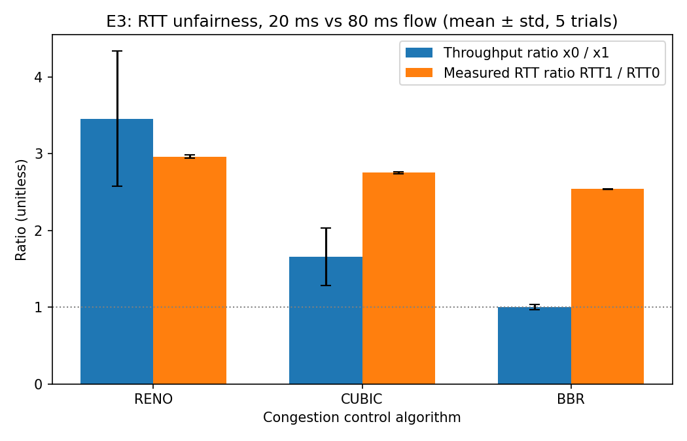
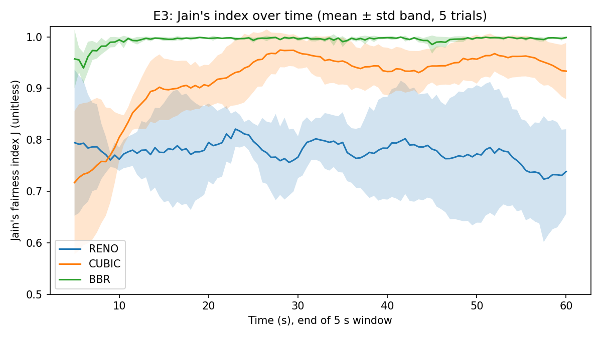
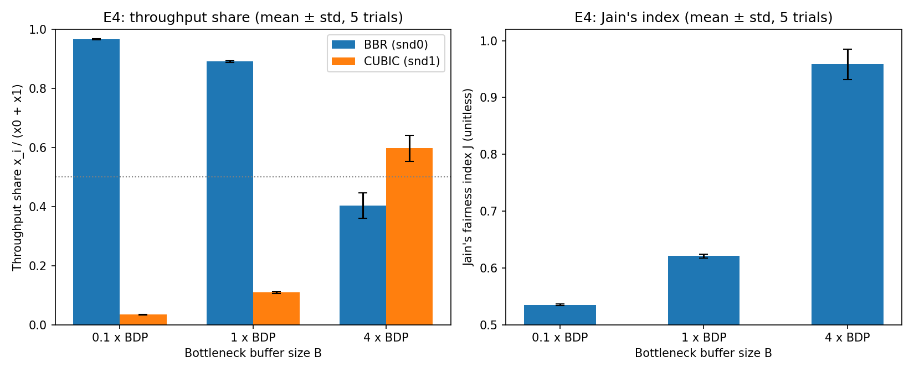

## E3. Two flows, same algorithm, different RTTs

**What we test:** two flows share the bottleneck, one with a short RTT (20 ms) and one with a long RTT (80 ms). Which one gets more bandwidth, and does it depend on the algorithm?

### How to run

```bash
# 1. Start the network: snd0 gets 10 ms each way (20 ms RTT), snd1 gets 40 ms (80 ms RTT)
sudo python3 dumbbell.py --bw 50 --delay 10ms --delay1 40ms --buf 1

# 2. In a second terminal, write the trial commands (5 trials per algorithm)
python3 gen_trials.py e3_d40_reno  reno  reno  1 5 > e3_d40_reno.txt
python3 gen_trials.py e3_d40_cubic cubic cubic 1 5 > e3_d40_cubic.txt
python3 gen_trials.py e3_d40_bbr   bbr   bbr   1 5 > e3_d40_bbr.txt

# 3. At the mininet> prompt, run them
mininet> source e3_d40_reno.txt
mininet> source e3_d40_cubic.txt
mininet> source e3_d40_bbr.txt
```

`gen_trials.py` only writes the handout's commands for us (one `ss` sampler per sender, both iperf3 flows, then a 10 s wait), so every trial is started the same way and the file names are always correct. Raw data is in `data/e3/`.

### Results (mean ± std over 5 trials)

| Algorithm | x0 / x1 (throughput ratio) | RTT1 / RTT0 (measured) | (RTT1 / RTT0)² |
| --- | --- | --- | --- |
| Reno | 3.45 ± 0.88 | 2.96 ± 0.02 | 8.79 |
| CUBIC | 1.66 ± 0.37 | 2.75 ± 0.01 | 7.57 |
| BBR | 1.00 ± 0.03 | 2.54 ± 0.01 | 6.45 |

In every trial the two flows together used the whole link (47–48 Mbps).





### Explanation

**Why the RTT ratio is below 4.** We configured 20 ms and 80 ms (4×), but both flows wait in the same bottleneck queue, which adds the same delay to both RTTs. For Reno that is about 10 ms, so the RTTs become ~30 and ~90 ms, a ratio of ~3. The more queue an algorithm keeps, the smaller the ratio, which is why the orange bars get shorter from Reno to BBR. This is why we used the measured RTTs (average `rtt` from the `ss` samples) and not the configured ones.

**Reno.** Reno adds one packet to cwnd per RTT and halves it on a loss. The short flow gets about 3× more RTTs per second, so it grows about 3× faster and recovers faster after every loss. It got about 3.5× more bandwidth, close to the simple model (x0 / x1 = RTT1 / RTT0) and far from the squared version (8.79). The 3.45 is a bit above 2.96, but Reno's error bar is large and includes 2.96, so the difference could be trial-to-trial noise. Reno's Jain's index stays around 0.75–0.80 the whole run and has the widest band: Reno halves cwnd on every loss, and losses happen at random moments, so some trials favor the short flow much more than others (x0 / x1 ranged from 2.40 to 4.79).

**CUBIC.** CUBIC grows cwnd based on the time since the last loss, not per RTT, so both flows grow at a similar pace. That removes most of Reno's advantage for the short flow (1.66 instead of 3.45). It is still not equal because throughput ≈ cwnd / RTT: with the same cwnd, the long flow delivers less per second. In the Jain plot, CUBIC starts unfair (~0.72) because in slow start cwnd doubles every RTT, so the short flow doubles about 3× as often and grabs the link first. After slow start, CUBIC's time-based growth lets the long flow catch up, and J levels off around 0.95 after about 25 s.

**BBR.** BBR does not grow cwnd per RTT or react to loss. It sends at a rate based on its estimate of the bottleneck bandwidth, so the long RTT does not slow it down. Both flows got almost exactly equal shares (1.00 ± 0.03), and J stays near 1.0 from about 10 s on, with a very thin band.

**Deviation: BBR had the most queueing.** BBR is supposed to keep the queue near empty, but in E3 it had the highest queueing delay (~19 ms, vs ~14 ms for CUBIC and ~10 ms for Reno). Our understanding is that with two BBR flows, each flow's bandwidth estimate also includes room the other flow is using, so together they keep extra data in flight, which sits in the queue. This assumption of BBR's model (one flow, alone on the path) does not hold here.

**Note:** CUBIC trial 1 was rerun. In the first run, snd1's iperf3 stopped after 1.5 s (`control socket has closed unexpectedly`), so snd0 ran mostly alone. We deleted that trial's JSON files and ran it again.

## E4. BBR vs CUBIC

**What we test:** one BBR flow (snd0) and one CUBIC flow (snd1) share the bottleneck with the same RTT (20 ms). Who gets more bandwidth, and does the buffer size change the winner?

### How to run

```bash
# Write the trial commands once (BBR on snd0, CUBIC on snd1)
python3 gen_trials.py e4_b0.1_bbrcubic bbr cubic 1 5 > e4_b0.1.txt
python3 gen_trials.py e4_b1_bbrcubic   bbr cubic 1 5 > e4_b1.txt
python3 gen_trials.py e4_b4_bbrcubic   bbr cubic 1 5 > e4_b4.txt

# Then, for each buffer size, start the network and run its batch
sudo python3 dumbbell.py --bw 50 --delay 10ms --buf 0.1    # then: mininet> source e4_b0.1.txt
sudo python3 dumbbell.py --bw 50 --delay 10ms --buf 1      # then: mininet> source e4_b1.txt
sudo python3 dumbbell.py --bw 50 --delay 10ms --buf 4      # then: mininet> source e4_b4.txt
```

Type `exit` between buffer sizes, since the buffer is set when the network starts. The handout does not say how to name mixed-algorithm runs, so we used `bbrcubic` as the algorithm part of the file name. Raw data is in `data/e4/`.

### Results (mean ± std over 5 trials)

| Buffer | BBR (Mbps) | CUBIC (Mbps) | BBR share | Jain's J |
| --- | --- | --- | --- | --- |
| 0.1 × BDP (8 packets) | 44.5 ± 0.6 | 1.6 ± 0.1 | 0.966 ± 0.002 | 0.535 ± 0.002 |
| 1 × BDP (83 packets) | 41.8 ± 0.2 | 5.1 ± 0.1 | 0.891 ± 0.003 | 0.621 ± 0.004 |
| 4 × BDP (333 packets) | 19.5 ± 2.1 | 28.8 ± 2.0 | 0.403 ± 0.044 | 0.959 ± 0.027 |



### Explanation

The key difference: **CUBIC cuts its cwnd every time it loses a packet, and BBR ignores losses** and keeps sending at the rate it measured for the bottleneck.

**Small buffer (0.1 × BDP): BBR wins (~97%).** With only 8 packets of buffer, losses happen constantly. CUBIC keeps backing off and never gets to grow, while BBR keeps the link full. Jain's index is 0.535, close to 0.5 ("one flow takes everything").

**Medium buffer (1 × BDP): BBR still wins (~89%).** CUBIC gets about 3× more than with the small buffer, but BBR still dominates. Our explanation is that BBR allows up to about 2 × BDP in flight, so BBR alone can keep most of an 83-packet queue full. CUBIC still sees frequent losses and keeps backing off.

**Big buffer (4 × BDP): CUBIC wins (~60%).** Now the queue is much bigger than what BBR keeps in it, so losses are rare. CUBIC keeps growing and fills the large queue with its own packets, and BBR's packets wait behind them. This matches the handout's expectation that CUBIC can win with deep buffers. This is also the fairest case (J ≈ 0.96), and the trials varied more (BBR share 0.37 to 0.47), because with a big queue the two flows go back and forth more over time.

**In one sentence:** with a small buffer, whoever ignores losses wins (BBR); with a big buffer, whoever fills the queue wins (CUBIC).

### Regenerating the plots

```bash
sudo apt install python3-matplotlib   # once
python3 analyze.py                    # prints the E3 and E4 tables and saves plots/*.png
```

`parse.py` reads the raw files (`parse_ss` for the `ss` samples, keeping the connection with the larger `bytes_acked`; `parse_iperf` for the JSON, with steady-state throughput = average of intervals starting at 5 s or later). `analyze.py` uses it to compute mean ± std over the 5 trials, Jain's index over a sliding 5 s window, and the plots.
